# Agentic AI — Production Support

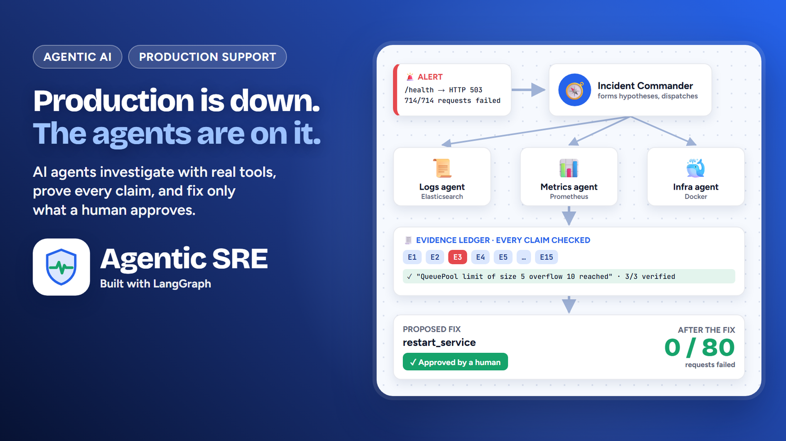

A team of LLM agents, orchestrated with **LangGraph**, that watches a running service
stack, investigates incidents with real tools, proves every claim with verifiable
evidence, and fixes what it is allowed to fix, after a human approves.

Nothing is scripted. Faults are real: a genuine database connection leak, or a stopped
container. Detection uses generic alert rules. Root cause, severity and the remediation
choice are decided by the agents from what their tools return. When the LLM is
unavailable, the system says so; it never falls back to canned answers.

<p align="center">
  
</p>

## Architecture

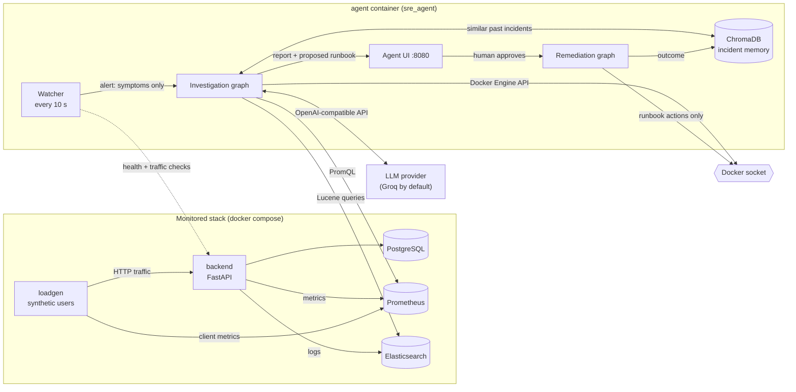

## How an incident is handled

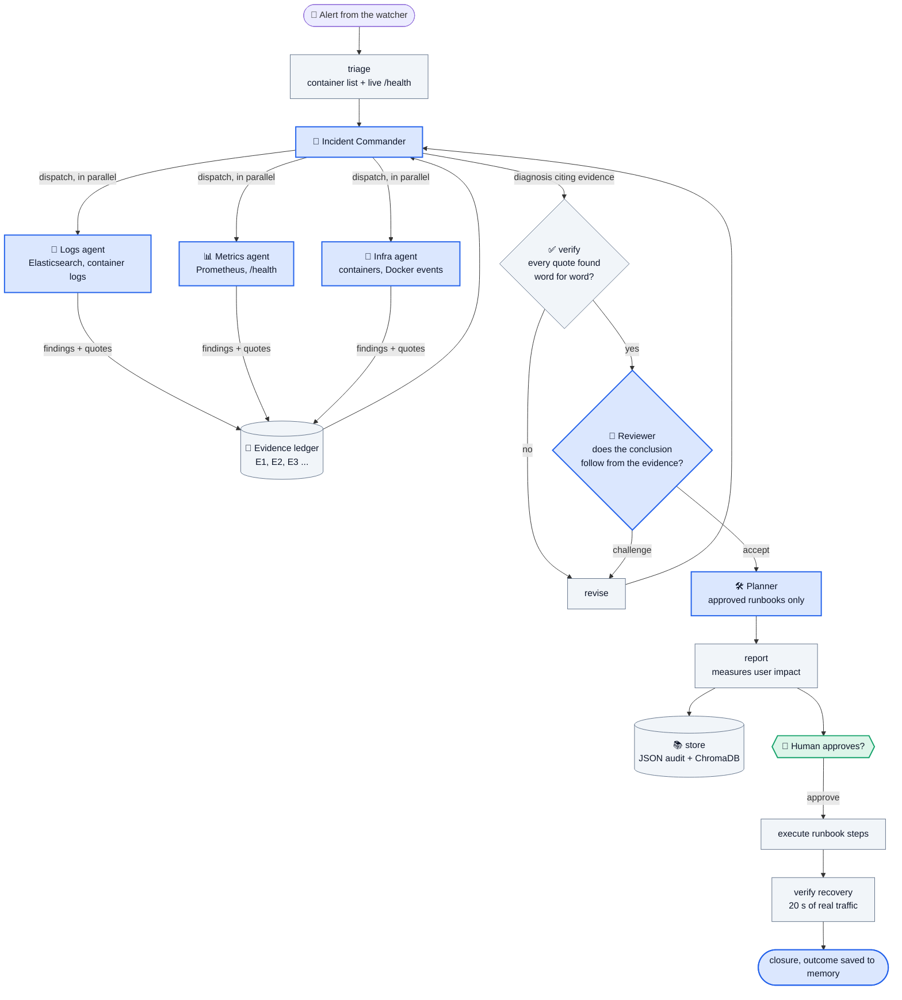

Blue nodes are LLM agents; grey nodes are deterministic code; green is the human gate.
The AI decides the root cause and which runbook fits. Checking quotes, running the fix and
measuring recovery are plain code, so a model cannot talk its way past them.

| Component | Role |
|---|---|
| **Watcher** | Every 10 s: critical containers running, `/health` OK, synthetic-client error ratio. Alerts after 2 consecutive failing checks. It is never told what was injected. |
| **Incident Commander** | Supervisor agent. Forms hypotheses, dispatches specialists in parallel, consults incident memory, submits a diagnosis that cites evidence. |
| **Specialists** | Logs (Elasticsearch, container output), Metrics (Prometheus, health endpoint), Infrastructure (container state, exit codes, Docker events). Each runs its own tool-calling loop. |
| **Evidence ledger + verifier** | Every tool result is recorded as `E1, E2, …`. Every claim must quote its evidence verbatim, and quotes are checked automatically, first when a specialist reports and again on the final diagnosis. |
| **Reviewer** | A skeptical second agent: does the root cause follow from the evidence, and which alternatives were not ruled out? It can send the diagnosis back. |
| **Remediation Planner** | Chooses from the approved runbooks in `runbooks.yaml`, or none. The proposal is validated against the catalog's allow-list. |
| **Remediation graph** | After human approval: runs the runbook's steps, then measures recovery independently (health, containers, 20 s of real client traffic). |
| **Synthetic client** | `loadgen/` sends steady user-like traffic and measures what users actually experience, even when the backend is too broken to report its own metrics. |
| **Incident memory** | ChromaDB semantic search over past diagnoses and how their fixes turned out, plus a JSON audit record per incident (full evidence ledger, token usage). |

## A real incident, end to end

A database connection leak was injected into the backend. Nothing told the agents what it was.

| | |
|---|---|
| **Impact** | 714 of 714 synthetic user requests failed over 179 s (`/health` and `/orders`) |
| **Detected** | Watcher alert 13 s after the first failing check: `/health` returning HTTP 503 |
| **Root cause** | SQLAlchemy connection pool exhausted (`QueuePool limit of size 5 overflow 10 reached`), found by the logs agent |
| **Evidence** | 15 tool results in the ledger; 3 of 3 cited quotes verified verbatim |
| **Fix** | Planner chose the `restart_service` runbook for `poc-backend`; executed after human approval |
| **Recovery** | Measured, not assumed: 0 of 80 requests failed over 20 s of real traffic afterwards |
| **Cost** | 23 LLM calls, about 35K tokens |

The full audit record, including every tool call and the evidence ledger, is in
[docs/examples/incident-connection-pool-exhausted.json](docs/examples/incident-connection-pool-exhausted.json).

The runbook catalog has four entries: `restart_service`, `start_stopped_service`,
`recover_database` and `restore_app_db_role`. The planner can propose only these, or nothing.

### The same incident, step by step

| | |
|:---:|:---:|
| **1. The watcher spots the problem**<br/>2 failed checks in a row, symptoms only<br/>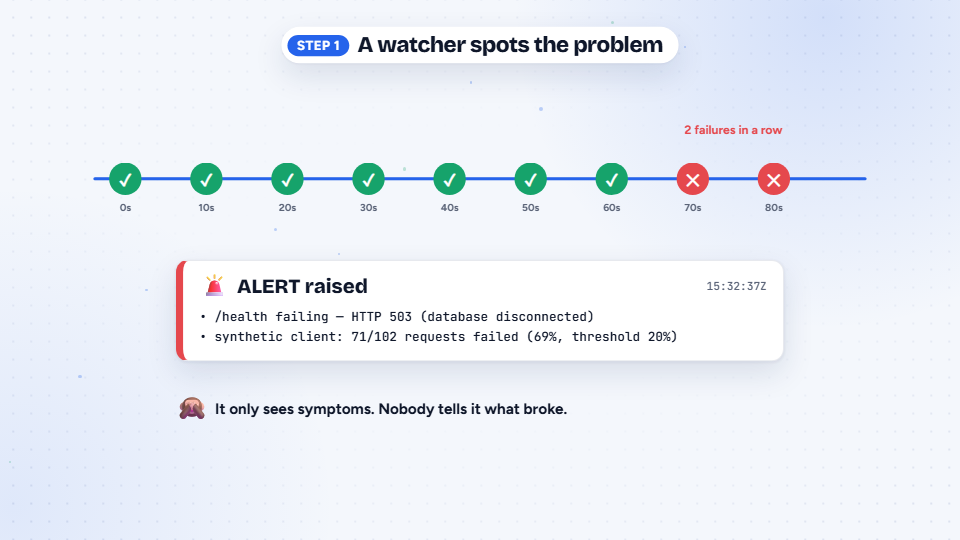 | **2. The commander sends specialists**<br/>logs, metrics and infra agents in parallel<br/>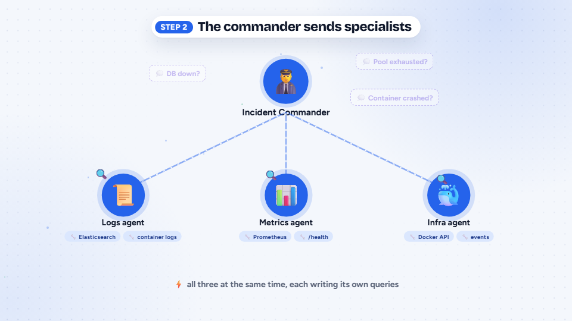 |
| **3. Every result becomes evidence**<br/>E3: the connection pool is full (15 / 15)<br/>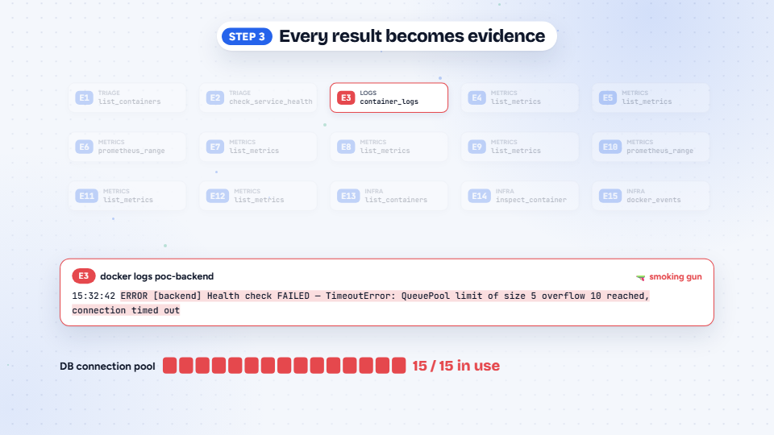 | **4. Every claim is checked**<br/>quotes matched word for word against raw output<br/>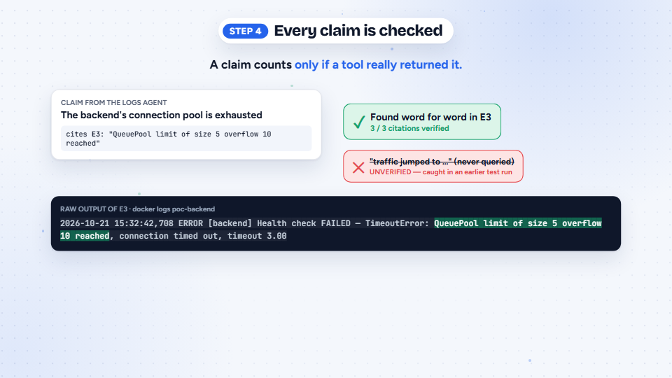 |
| **5. A skeptic reviews the logic**<br/>it can send the diagnosis back<br/>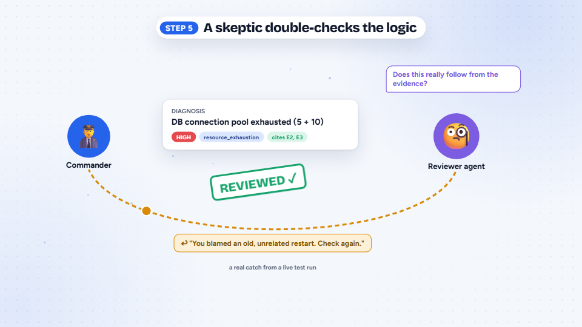 | **6. Only approved fixes, only with your OK**<br/>runbook catalog + human approval<br/>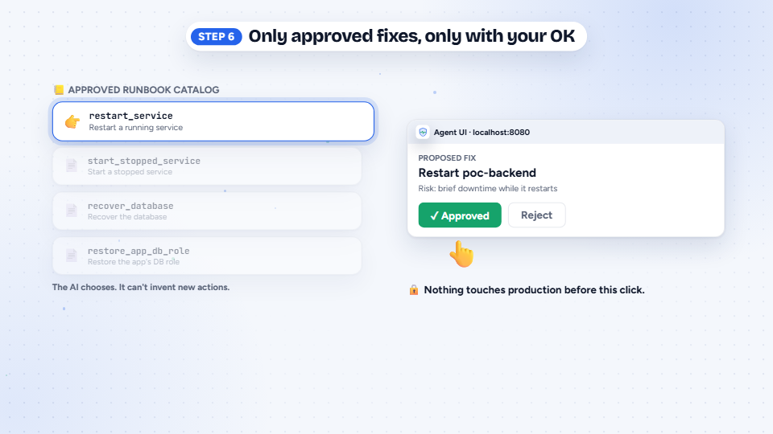 |
| **7. Fix it, then measure it**<br/>0 of 80 requests failed afterwards<br/>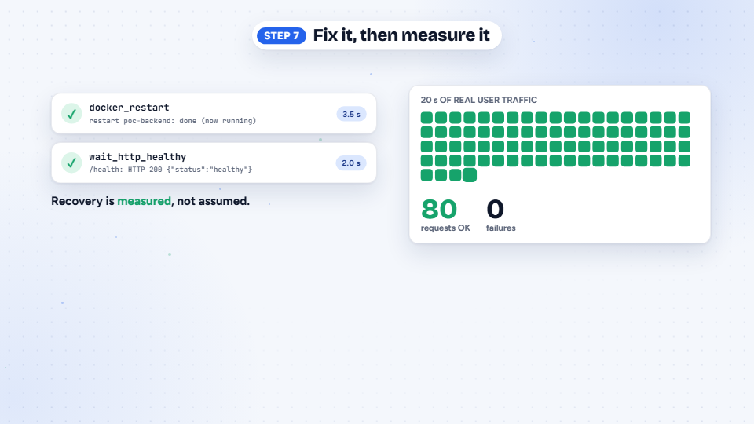 | **Incident lifecycle**<br/><br/>`idle` → `investigating` → `awaiting_approval` → `fixing` → `resolved`<br/><br/>or `manual_required` when no approved runbook applies, `failed` when the fix does not restore the service |

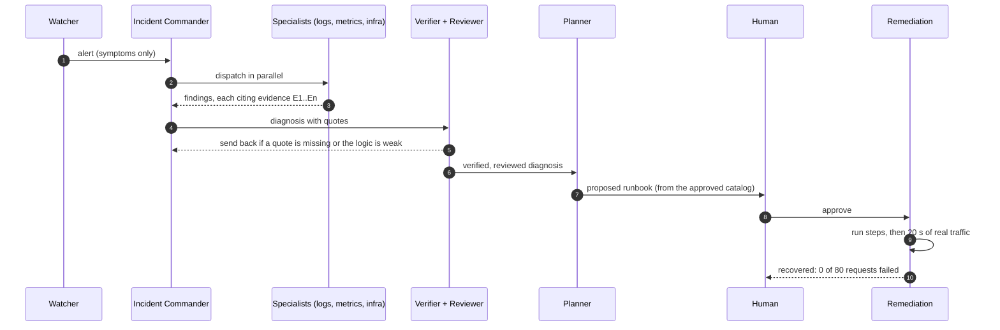

## Documentation

| Document | Contents |
|---|---|
| [docs/ARCHITECTURE.md](docs/ARCHITECTURE.md) | How it works, the evidence model, **what the AI decides vs. what is deliberately deterministic**, resilience, known limitations |
| [docs/CONFIGURATION.md](docs/CONFIGURATION.md) | Every environment variable |
| [docs/EXTENDING.md](docs/EXTENDING.md) | Adding tools, specialists, runbooks, alert rules; other LLM providers; LangGraph Studio; tests |
| [docs/PRODUCTION_ROOT_CAUSE_ROADMAP.md](docs/PRODUCTION_ROOT_CAUSE_ROADMAP.md) | Next phase: per-request root-causing |

## Repository layout

```
.
├── agent/                          the SRE agent (Python package: sre_agent)
│   ├── pyproject.toml              package metadata, pytest config
│   ├── langgraph.json              graph entry points for LangGraph Studio / CLI
│   ├── Dockerfile
│   ├── src/sre_agent/
│   │   ├── config.py               every setting, from environment variables
│   │   ├── api/                    FastAPI app, routes, SSE event bus, API-key auth, UI
│   │   ├── incidents.py            incident lifecycle (phases, approve, reset)
│   │   ├── watcher.py              alert rules + watch loop
│   │   ├── bootstrap.py            first-run setup of Portainer / Kibana / Gitea
│   │   ├── core/                   LLM client, evidence ledger, graph runtime context
│   │   ├── integrations/           Docker Engine API, incident store (ChromaDB + JSON)
│   │   ├── tools/                  agent tools: observability, infrastructure, memory
│   │   ├── agents/                 tool-calling agent loop + specialist roster
│   │   └── graphs/
│   │       ├── investigation/      state · prompts · schemas · graph · nodes/ (one per node)
│   │       └── remediation/        state · graph · nodes · actions · runbooks(.yaml)
│   └── tests/                      unit/ and graphs/ (graph tests use a scripted LLM)
├── backend/                        the monitored service: FastAPI + PostgreSQL
├── loadgen/                        synthetic client (black-box user traffic)
├── monitoring/                     Prometheus + Grafana provisioning
├── docs/                           architecture, configuration, extending, roadmap, example incident
├── docker-compose.yml
└── .env.example
```

The graphs follow LangGraph conventions: state is plain serialisable data
(`state.py`), and runtime dependencies (event emitter, evidence ledger, token
counters) are injected through LangGraph's runtime context (`core/context.py`). Each
graph module exports a compiled `graph`, referenced from `langgraph.json`.

## Quick start

```bash
cp .env.example .env      # set LLM_API_KEY and replace every change_me_* value
docker compose up -d --build
```

Open http://localhost:8080 and use the **Inject Incident** buttons. The watcher detects
the fault and the agents take over; approve the proposed runbook when the report
appears. Compose refuses to start while a required secret is missing.

> Database credentials are applied only when the `postgres_data` volume is first
> created. To change them later: `docker compose down -v`.

| Tool | URL |
|---|---|
| Agent UI | http://localhost:8080 |
| Grafana | http://localhost:3000 |
| Prometheus | http://localhost:9090 |
| Kibana | http://localhost:5601 |
| Portainer | http://localhost:9000 |

## LLM and rate limits

Any OpenAI-compatible endpoint works; Groq is the default. Providers rate-limit per model, so
agents that run at the same time use different models, and a fallback chain takes over when a
model's daily quota runs out (see [docs/CONFIGURATION.md](docs/CONFIGURATION.md#llm)).

On Groq's free tier (8K tokens/minute and 200K tokens/day per model) an investigation takes
about 2–6 minutes and 20–60K tokens, most of it waiting on the per-minute limit. A paid tier
makes it markedly faster.

## Tests

```bash
cd agent
pip install -e ".[dev]"
pytest
```

The graph tests run the real LangGraph graphs, agent loop, evidence verifier and runbook
validation against a scripted LLM, covering parallel dispatch, the verifier and reviewer
send-back loops, runbook allow-listing and LLM outage handling.

## Security

- Every state-changing endpoint (`/action/*`) requires `AGENT_API_KEY`. The UI receives it
  from the server, and the UI port is bound to `127.0.0.1`.
- The agent mounts the Docker socket so it can restart containers; run it only on a host
  you control. It can only perform the actions defined in the runbook catalog, and only
  after a human approves.
- The fault-injection endpoint needs its own token and leaves no trace in any log the
  agents can read.

## License

MIT. See [LICENSE](LICENSE).
