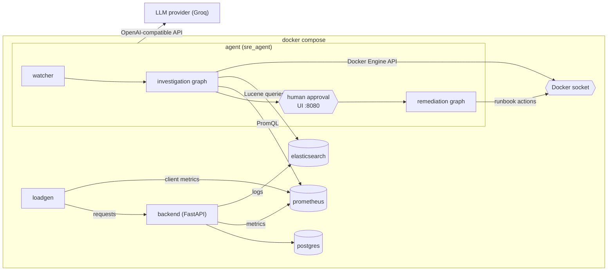
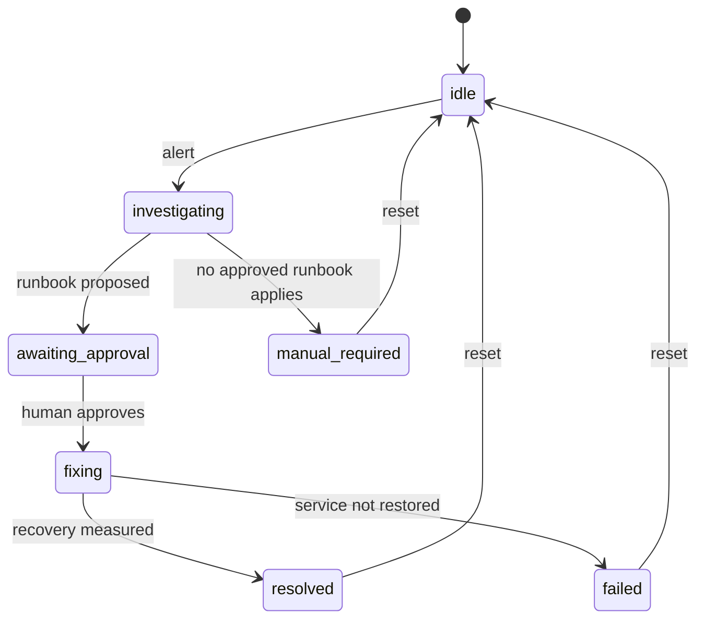
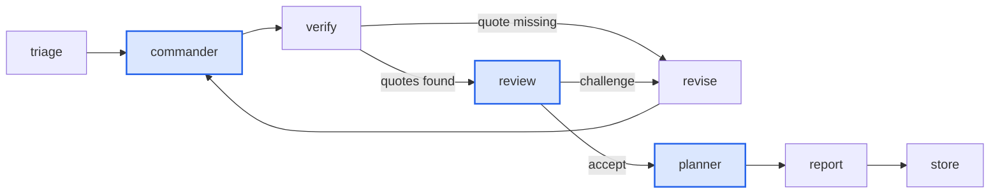
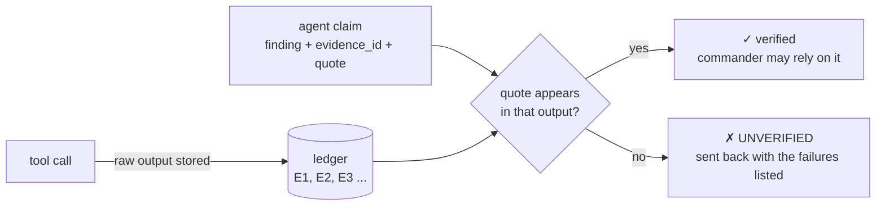
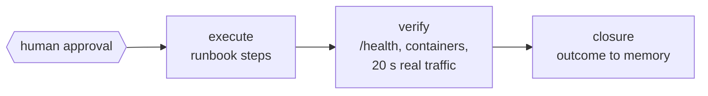

# Architecture

This document explains how the SRE agent works, which decisions are made by AI and which are
deliberately deterministic, and the design choices behind it.

## 1. System overview

| Service | Role |
|---|---|
| `backend` | The monitored service: FastAPI + PostgreSQL. Exposes request, latency, connection-pool and in-flight metrics, and ships logs to Elasticsearch. |
| `loadgen` | Synthetic client: about 4 requests/second of user-like traffic. Measures what users actually see, even when the backend is too broken to report its own metrics. |
| `prometheus`, `elasticsearch` | Where the agents read metrics and logs. |
| `agent` | Watcher, the two LangGraph graphs, the API and the UI. |
| `grafana`, `kibana`, `portainer`, `gitea` | Human-facing tooling; the agents do not depend on them. |

## 2. Incident lifecycle

1. **Detection.** `watcher.py` evaluates generic alert rules every 10 s. After 2 consecutive
   failures it raises an alert containing only the observed signals.
2. **Investigation.** The investigation graph turns the alert into a verified, reviewed diagnosis
   and, where an approved runbook fits, a remediation proposal.
3. **Approval.** A human approves or rejects the proposal in the UI. Nothing changes the system
   before this point.
4. **Remediation.** The remediation graph runs the runbook, then measures recovery independently.
5. **Memory.** The incident, its full evidence and the fix outcome are archived and indexed for
   future investigations.

Each incident is a **run** with its own id (`incidents.py`). Only one run is active: a new alert or
a reset cancels the previous run, and late events from a cancelled run are dropped. In the UI each
run is one card, split into sections (Detection, Triage, Investigation, Evidence check, Review,
Remediation plan, Report, Execution, Recovery check, Closure). The graph nodes open these sections
with `RunContext.stage()`. The Investigation section shows one block per agent, so specialists
working in parallel do not interleave.

## 3. Investigation graph

Blue nodes call the LLM; the rest are deterministic.

| Node | Kind | What it does |
|---|---|---|
| `triage` | deterministic | Records two first observations as evidence: the container list and a live `/health` call. |
| `commander` | **AI (supervisor)** | Forms hypotheses, dispatches specialists (several in parallel), searches incident memory, and submits a diagnosis that cites evidence. |
| `verify` | deterministic | Checks that every quoted piece of evidence exists verbatim in the recorded tool output. |
| `review` | **AI** | A skeptical second agent judges whether the root cause follows from the evidence and lists alternatives that were not ruled out. |
| `revise` | deterministic | Returns the verifier's or reviewer's feedback to the commander (at most `MAX_DIAGNOSIS_REVISIONS` times). |
| `planner` | **AI** | Chooses a runbook from the approved catalog, or none. The choice is validated against the catalog's allow-list. |
| `report` | deterministic | Measures user impact from the synthetic client and publishes the report. |
| `store` | deterministic | Archives the record (JSON) and indexes it in ChromaDB. |

### Specialist agents

The commander never queries systems itself; it dispatches specialists through the
`dispatch_specialist` tool. Each specialist runs its own reason → act → observe loop
(`agents/runner.py`) with a toolset scoped to its domain:

| Specialist | Tools |
|---|---|
| Logs | `search_logs` (Elasticsearch, Lucene syntax), `container_logs` |
| Metrics | `list_metrics`, `prometheus_query`, `prometheus_range`, `check_service_health` |
| Infrastructure | `list_containers`, `inspect_container`, `docker_events`, `container_logs` |

The agents write their own queries; for example, the metrics agent discovers metric names with
`list_metrics` and then writes PromQL.

## 4. The evidence model: how hallucination is contained

The central design rule is that **a claim counts only if a tool actually returned it**.

1. Every tool call is stored in the **evidence ledger** (`core/evidence.py`) with an id
   (`E1`, `E2`, …) and its raw output.
2. Specialists must report findings as `{finding, evidence_id, quote}`. Each quote is checked
   against the cited output **before the commander sees it**; unverifiable findings reach the
   commander marked `✗ UNVERIFIED — do not rely on this`.
3. The commander's diagnosis is checked the same way (`verify` node). A quote may use `…` to
   omit text, but every fragment must appear in order.
4. If any citation fails, the diagnosis goes back to the commander with the failures listed.
5. The **reviewer** catches the remaining gap: quotes can be real while the conclusion drawn from
   them is not. It challenges unsupported causal claims and untested alternatives.
6. Reported confidence = the model's self-assessed confidence × the share of citations verified.

Observed in live runs: the verifier caught a specialist inventing a traffic figure it never
queried, and the reviewer caught a commander blaming an earlier, unrelated container restart.

## 5. Remediation graph

- **execute** runs the steps of the approved runbook (`runbooks.yaml`) through a fixed
  vocabulary of six actions (`graphs/remediation/actions.py`), stopping at the first failure.
- **verify** measures recovery independently of the steps: `/health`, critical container states,
  and 20 s of real synthetic-client traffic.
- **closure** has the AI write the closure note from the measured facts. If the LLM is
  unavailable, the facts are published verbatim. The outcome is written back to incident memory.

## 6. What the AI decides, and what is deliberately deterministic

| Decision | Made by | Why |
|---|---|---|
| What to investigate, which queries to run | **AI** (commander + specialists) | |
| Root cause, failure category, severity, timeline | **AI** (commander) | |
| Whether the reasoning holds | **AI** (reviewer) | |
| Which fix to propose, or none | **AI** (planner) | |
| Closure note | **AI** | |
| Whether something is wrong at all (alert rules) | Deterministic thresholds | Alerting must be predictable and cheap; this is how Prometheus alert rules work in production. |
| Whether a quote is real | Deterministic string check | The check against hallucination must not itself be an LLM. |
| What fixes exist and what they do | Runbook catalog (YAML) | Safety: the AI chooses, but cannot invent actions. |
| Whether to execute | **Human** | Changes to production need approval. |
| Whether the fix worked | Deterministic measurement | Recovery is measured, never assumed. |
| User impact | Deterministic measurement (PromQL) | It is a number, not an opinion. |

Nothing in the agent code or prompts describes this system's failure modes. The prompts describe
an investigation *method* and rules of evidence. If the LLM is unavailable, the report states "AI
investigation unavailable" and proposes no fix; there are no fallback rules.

## 7. LangGraph conventions used

- **State is plain data** (`graphs/*/state.py`): alert, diagnosis, verification, proposal and so on.
- **Runtime dependencies go in the runtime context** (`core/context.py`, LangGraph `context_schema`):
  the event emitter, the evidence ledger and token counters. This keeps state serialisable for
  checkpointing and lets the graphs run standalone in LangGraph Studio with default context.
- **One module per node** (`graphs/investigation/nodes/`), with routing functions next to the
  wiring in `graph.py`.
- **Structured agent outputs as final tools** (`schemas.py`): each agent ends by calling its tool,
  and the arguments are its answer.
- Each graph module exports a compiled `graph`; `langgraph.json` registers both.

## 8. Resilience

| Problem | Handling |
|---|---|
| Per-minute rate limit (429) | Wait exactly as long as the provider says, then retry. |
| Daily quota exhausted | Switch to the next model in `LLM_FALLBACK_MODELS`; remember the exhausted model until its reset time. |
| Request too large (413) | Compact older tool outputs (the ledger keeps the full text) and retry. |
| Model ignores the forced final tool call | Retry without forcing; grace rounds in which only the final tool executes. |
| Specialist fails mid-task | Its raw observations are returned to the commander as citable evidence. |
| Revision fails | Keep the previous verified diagnosis and report the reviewer's open concerns. |
| LLM fully unavailable | Report says so, archives the evidence, proposes no fix. |
| Stale data after a fix | Watcher window of 30 s plus a quiet period after a successful fix. |

## 9. Known limitations

- **Diagnosis depth depends on the model.** The evidence guarantees keep claims honest, but a
  smaller model may stop at "pool exhausted" without determining *why*. When that happens it says
  so in `open_questions`.
- **Free-tier rate limits** make investigations take 2–6 minutes. A paid tier is much faster.
- **Review rounds cost time and tokens.** Each reviewer challenge sends the commander back to
  investigate. `MAX_DIAGNOSIS_REVISIONS` caps this; unresolved concerns are reported, not hidden.
- **The scope is service-level failures** with four automated runbooks. Per-request root-causing
  (stack traces, deploy correlation, code fixes) is covered in
  [PRODUCTION_ROOT_CAUSE_ROADMAP.md](PRODUCTION_ROOT_CAUSE_ROADMAP.md).
- **Single-process state.** The incident phase is held in memory. A multi-replica deployment would
  move it to a store and use a LangGraph checkpointer.
